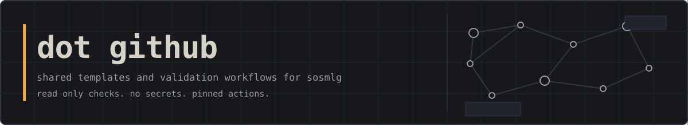

# .github

Shared issue templates, security policy and validation workflows for the SOSMLG repositories. The workflows only parse files and check repository hygiene. They do not install software or change system state.

[read the git guide](docs/GIT_GUIDE.md)

| | |
| --- | --- |
| **templates** | Repos inherit issue and pull request templates unless they ship their own copy. |
| **workflows** | Shell, PowerShell, JSON/XML/YAML and docs checks. All use `contents: read`. |
| **languages** | English is canonical. Arabic guides live under `docs/`. |
| **secrets** | No secrets are used. Actions are pinned to full commit SHAs. |

## Docs

- [Git guide](docs/GIT_GUIDE.md)
- [دليل Git](docs/GIT_GUIDE.ar.md)
- [Visual standard](docs/THEME.md)
- [المعيار البصري](docs/THEME.ar.md)
- [Contributing](CONTRIBUTING.md)
- [Security](SECURITY.md)

## Workflows

- `validate-shell.yml`: `bash -n`, conflict markers, whitespace.
- `validate-powershell.yml`: PowerShell parser, conflict markers, whitespace.
- `validate-json-xml.yml`: JSON, XML and YAML parsing.
- `validate-docs.yml`: local Markdown links, language policy, whitespace.

All workflows use `permissions: contents: read`. Actions are pinned to full commit SHAs. No secrets are used.
